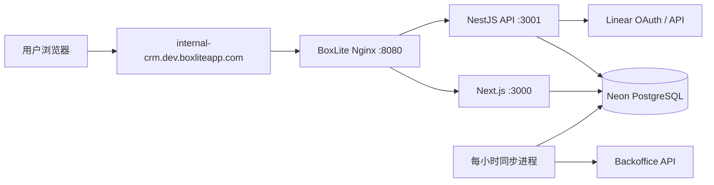

# BoxLite CRM 内部工程手册

维护日期：2026-11-13。适用对象：开发者、发布执行人、维护该项目的 Agent。

本目录记录 BoxLite 定制版本的实际操作流程。部署脚本和配置发生变化时，同一提交更新对应 SOP。
“内部”表示文档用途；目录本身不提供访问控制。不得写入密码、token、数据库连接串、客户导出数据。

## 文档入口

| 文档 | 使用场景 |
| --- | --- |
| [本地开发 SOP](development.md) | 建立隔离环境、启动应用、开发、测试、提交 |
| [线上发布 SOP](release.md) | 确认版本、备份、发布到 BoxLite、验收、代码回退 |
| [运维与恢复 SOP](operations.md) | 同步排查、登录排查、数据库迁移、sandbox 重建 |
| [发布记录模板](release-record-template.md) | 留存版本、验证结果、备份位置和回退决策 |

## 当前环境基线

以下资源 ID 是核对线索。执行发布前检查私密部署状态文件和平台实际状态，不能仅依赖本表。

| 项目 | 当前值 |
| --- | --- |
| 代码仓库 | `https://github.com/Mandalorian-Wang/crm` |
| 发布分支 | fork 的 `main`，不是上游仓库，也不是 `release` |
| 常用本地发布目录 | `/Users/markovwong/CodeProject/boxlite_crm` |
| 线上入口 | `https://internal-crm.dev.boxliteapp.com` |
| BoxLite API | `https://api.dev.boxlite.ai` |
| Sandbox | `uTE4Z8Pj1LM7`，名称 `boxlite-crm-dev` |
| Sandbox 应用目录 | `/app/crm` |
| Neon Organization | `org-green-cake-64297294` |
| Neon Project | `steep-frost-79122866` |
| Neon Branch | `production` / `br-jolly-art-becax57d` |
| PostgreSQL 数据库 | `neondb` |
| 登录 | Linear SSO，仅 `polygala.ai`；另有指定管理员密码入口 |
| 数据同步 | 每小时；GitHub 同步关闭 |

## 运行关系

- Supervisor 管理 `api`、`web`、`sync`、`nginx`。
- PostgreSQL 数据在 Neon。重建 sandbox 后重新连接同一数据库，不重新导入或清空现有数据。
- 同步追加新记录，刷新来源管理字段。人工备注、类型、owner、收藏和绑定继续保留。
- 自定义 Organization type 位于 Settings → Dictionaries；选项、颜色和分配结果均在 Neon。

## 配置与证据存放

| 内容 | 存放位置 | Git |
| --- | --- | --- |
| 变量定义及非敏感示例 | 根目录 `.env.example` | 提交 |
| 当前 checkout 的私密配置 | 根目录 `.env` | 忽略，权限 `600` |
| Neon 项目关联 | 根目录 `.neon` | 忽略 |
| BoxLite 部署状态 | `deploy/boxlite/.local/deployment.json` | 忽略 |
| 数据库备份、私密日志、发布配置快照 | `deploy/boxlite/.local/` | 忽略 |
| 无密钥发布记录 | `docs/internal/releases/`，按需创建 | 可提交 |

根目录 `.env.local` 会覆盖 `.env` 中的同名设置。发布时不得残留开发用覆盖文件。
操作系统已设置的环境变量优先；不能仅看 `.env` 判断运行时连接。

## 文档优先级

本目录描述当前 BoxLite + Neon 发布流程。原有 [部署说明](../../deploy/boxlite/README.md) 包含历史功能和 standalone 本地 PostgreSQL 方案。
数据库连接和迁移细节见 [Neon 手册](../../deploy/boxlite/NEON.md)。开发约束仍遵循 [AGENTS.md](../../AGENTS.md)、[API 规则](../api.md)、[UI 规则](../design.md)、[环境规则](../environment.md) 和 [测试规则](../../CONTRIBUTING.md)。

一次发布至少保留：commit SHA、执行人、环境、迁移结果、构建结果、验收结果和备份位置。
